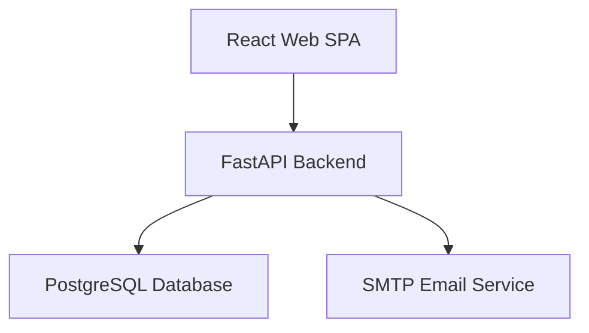
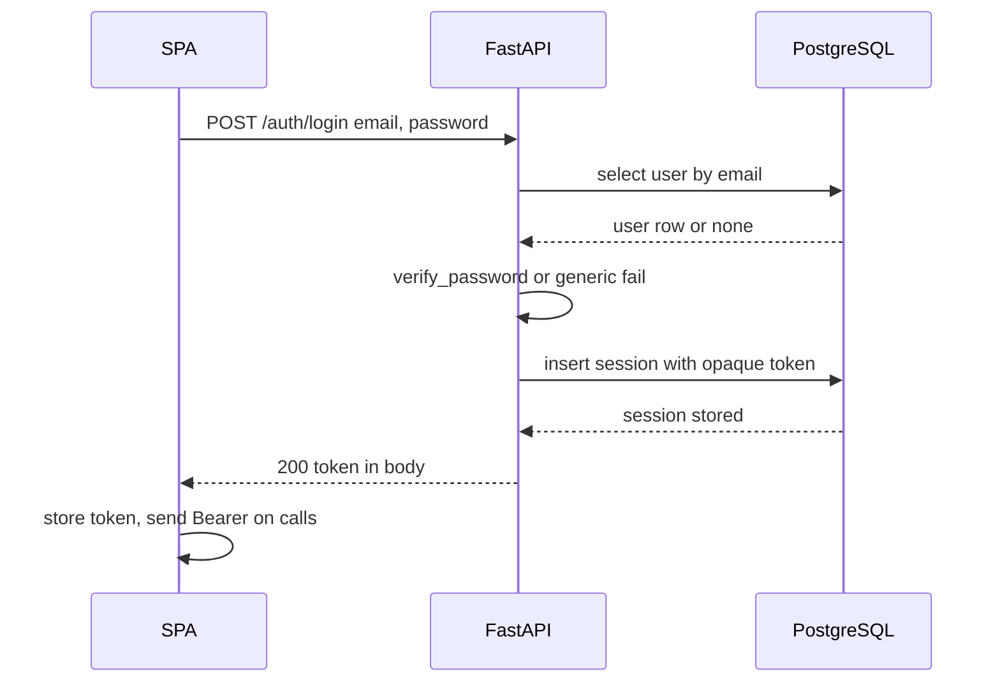
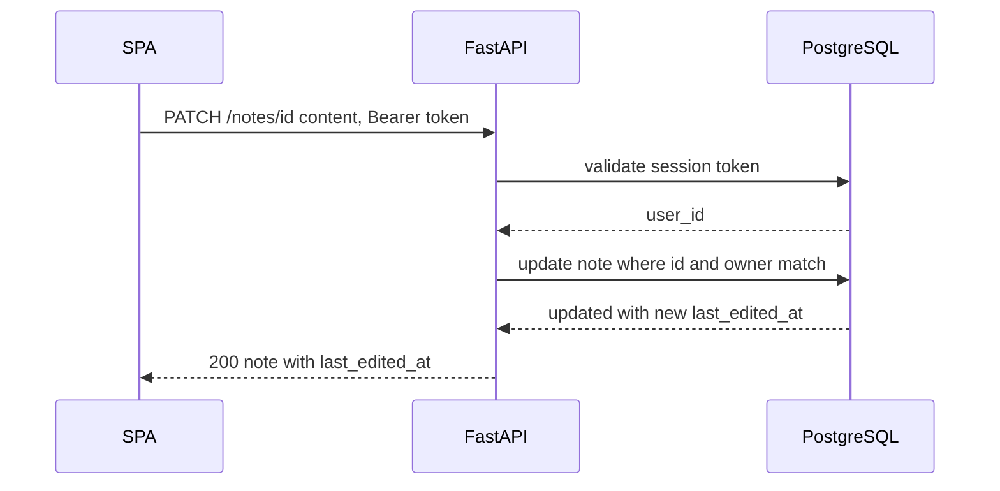
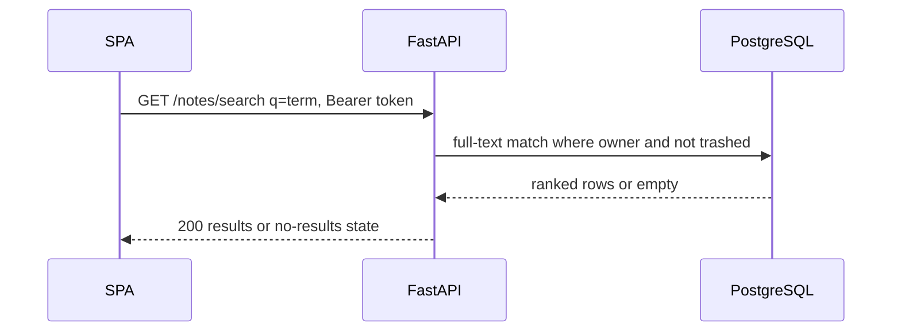
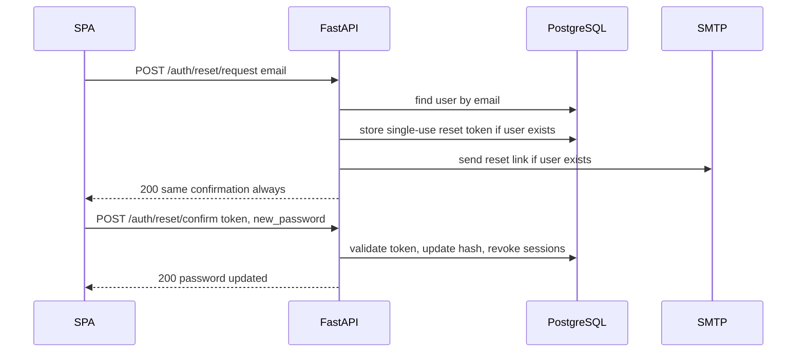
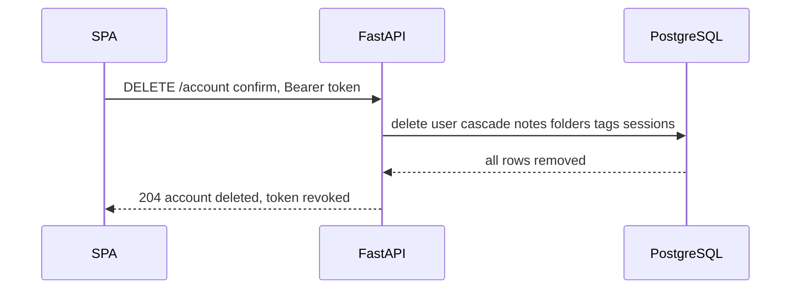
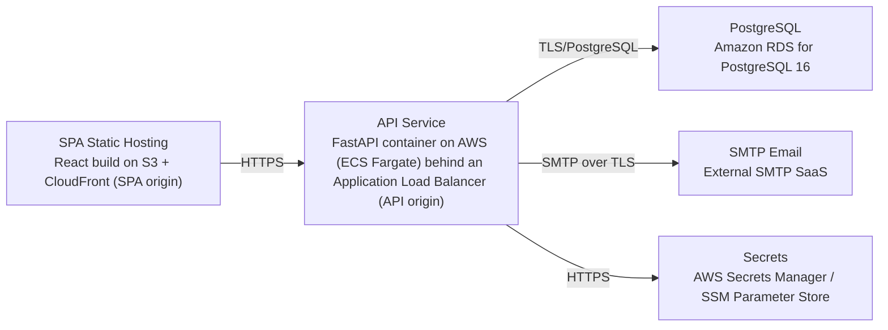

# Architecture

> Maintained by QuorQ AI SDLC. Text between `sdlc:auto` markers is regenerated; anything outside them is yours and is kept.

<!-- sdlc:auto:start narrative -->
## Overview

### ARCH-COMP-WEB · approved · source: architecture:web_frontend

React 19 single-page application providing the entire end-user browser experience: registration/sign-in, note dashboard, rich-text editor with auto-save, folders/tags, search, trash and account settings.

Component: React Web SPA (React 19). Responsibilities: registration/sign-in UI, note list dashboard, rich-text editor with auto-save, folders/tags organisation, search UI, trash area, and account settings. Stores the opaque session token issued by the backend and sends it as 'Authorization: Bearer <token>' on every API call. Reads API base URL from VITE_API_BASE_URL. Served as static assets from its own origin.

**Related:** ARCH-COMP-API

### ARCH-COMP-API · approved · source: architecture:api_backend

FastAPI 0.115 backend exposing the REST API for auth/sessions, note CRUD with auto-save, folders/tags, full-text search, trash lifecycle, password reset, and self-service account deletion.

Component: FastAPI Backend (FastAPI 0.115). Responsibilities: auth and session management, note CRUD with auto-save, folders/tags, full-text search, trash lifecycle, password reset, self-service account deletion. Enforces per-user data isolation on every query and hashes passwords before storage. Runs on Python 3.12 / Uvicorn.

**Related:** ARCH-COMP-WEB, ARCH-COMP-DB, ARCH-COMP-EMAIL

### ARCH-COMP-DB · approved · source: architecture:database

Single PostgreSQL 16 database as the durable store for all structured data, also providing built-in full-text search so no separate search engine is needed.

Component: PostgreSQL Database (PostgreSQL 16). Stores users, sessions, notes (rich-text content), folders, tags, note-tag links, and trash state. Provides full-text search via tsvector/GIN indexes, eliminating the need for a separate search engine.

**Related:** ARCH-COMP-API, ARCH-DATA-MODEL

### ARCH-COMP-EMAIL · approved · source: architecture:email_service

External SMTP SaaS used to send transactional password-reset emails containing a time-limited, single-use link.

Component: SMTP Email Service (external SMTP SaaS). Sole responsibility: send transactional password-reset emails with a time-limited, single-use link. Managed/external, invoked by the API backend only during the password-reset flow.

**Related:** ARCH-COMP-API, ARCH-CRIT-RESET

### ARCH-CRIT-SIGNIN · approved · source: architecture:critical_path:sign-in

Describes how a user signs in and how the resulting session token is issued and used thereafter.

User submits email/password; backend verifies the password hash and issues an opaque session token persisted server-side (sessions table). On failure, a generic error is returned so email existence is not revealed. The token persists per device and is sent as a Bearer header on every subsequent API call. Endpoints involved: POST /auth/login, POST /auth/logout.

**Related:** ARCH-COMP-API, ARCH-COMP-DB

### ARCH-CRIT-AUTOSAVE · approved · source: architecture:critical_path:auto-save

Describes the debounce-and-PATCH mechanism used to auto-save note edits with an updated last-edited timestamp and search index.

As the user pauses typing, the SPA debounces changes and PATCHes the note content to the backend. The backend updates content, refreshes last_edited_at, and recomputes the full-text search vector, all scoped to the owning user. Endpoint: PATCH /notes/{id}.

**Related:** ARCH-COMP-WEB, ARCH-COMP-API, ARCH-COMP-DB

### ARCH-CRIT-SEARCH · approved · source: architecture:critical_path:full-text-search

Describes how full-text search is executed over a user's active notes, excluding trashed notes.

User enters a search term; backend runs a PostgreSQL full-text query (tsvector/GIN) over the user's non-trashed notes, returning matches or a no-results state. Trashed notes are explicitly excluded from results. Endpoint: GET /notes/search.

**Related:** ARCH-COMP-DB, ARCH-COMP-API

### ARCH-CRIT-RESET · approved · source: architecture:critical_path:password-reset

Describes the password-reset flow, including its account-existence-safe confirmation message and session revocation on completion.

User requests a reset; backend always returns the same confirmation message regardless of whether the account exists. Only for an existing account does the backend create a time-limited, single-use reset token and send the link via SMTP. Setting a new password updates the password hash and revokes all existing sessions. Endpoints: POST /auth/reset/request, POST /auth/reset/confirm.

**Related:** ARCH-COMP-API, ARCH-COMP-EMAIL, ARCH-COMP-DB

### ARCH-CRIT-DELETE · approved · source: architecture:critical_path:account-deletion

Describes the self-service account deletion flow and its cascading, transactional removal of all user data.

A signed-in user confirms deletion; the backend permanently removes the user and cascades deletion of all notes (including trashed ones), folders, tags, note-tag links, and sessions within a single transaction. Endpoint: DELETE /account.

**Related:** ARCH-COMP-API, ARCH-COMP-DB

### ARCH-DATA-MODEL · approved · source: architecture:entities

Relational data model covering users, sessions, password reset tokens, folders, notes, tags, and note-tag links, all scoped by user ownership.

Entities and key fields: users(id, email, password_hash, created_at); sessions(id, user_id, token_hash, created_at, last_used_at, expires_at); password_reset_tokens(id, user_id, token_hash, expires_at, used_at, created_at); folders(id, user_id, name, created_at); notes(id, user_id, folder_id, title, content_html, content_text, search_vector, is_trashed, trashed_at, last_edited_at, created_at); tags(id, user_id, name); note_tags(note_id, tag_id). notes.search_vector backs PostgreSQL full-text search via tsvector/GIN indexing.

**Related:** ARCH-COMP-DB

### ARCH-API-AUTH · approved · source: architecture:endpoints:auth

Authentication, session, and account-deletion endpoints.

POST /auth/register - self-register with email and password; rejects duplicate email and invalid fields. POST /auth/login - sign in; returns opaque session token in body, generic error on failure. POST /auth/logout - ends current session by revoking its token. POST /auth/reset/request - request a password reset; always returns same confirmation regardless of account existence. POST /auth/reset/confirm - set a new password using a time-limited single-use reset token; revokes existing sessions. DELETE /account - permanently delete the account and all associated data after confirmation; revokes sessions.

**Related:** ARCH-CRIT-SIGNIN, ARCH-CRIT-RESET

### ARCH-API-NOTES · approved · source: architecture:endpoints:notes

Endpoints for listing, creating, reading, updating, and searching notes.

GET /notes - list the user's active (non-trashed) notes with title/preview and last-edited timestamp; supports folder_id and tag_id filters. POST /notes - create a new empty note owned by the user. GET /notes/{id} - get a single owned note with its rich-text content and tags. PATCH /notes/{id} - auto-save note changes (title, content, folder); updates last_edited_at and search vector. GET /notes/search - full-text search over the user's active notes by title/content; excludes trashed notes.

**Related:** ARCH-CRIT-AUTOSAVE, ARCH-CRIT-SEARCH, ARCH-DATA-MODEL

### ARCH-API-TRASH · approved · source: architecture:endpoints:trash

Endpoints for moving notes to trash, restoring them, and permanently deleting trashed notes individually or all at once.

POST /notes/{id}/trash - move the note to trash so it leaves the active list. POST /notes/{id}/restore - restore a trashed note to the active list with its previous content and organisation. DELETE /notes/{id} - permanently delete a trashed note so it cannot be restored or found in search. GET /trash - list the user's trashed notes with last-edited timestamps. DELETE /trash - empty the trash, permanently removing all trashed notes after confirmation.

**Related:** ARCH-CRIT-SEARCH, ARCH-DATA-MODEL

### ARCH-API-FOLDERS-TAGS · approved · source: architecture:endpoints:folders-tags

Endpoints for managing folders and tags, and for attaching/removing tags on notes.

GET /folders - list the user's folders. POST /folders - create a folder. DELETE /folders/{id} - delete a folder; its notes become unfiled. GET /tags - list the user's tags. POST /notes/{id}/tags - add one or more tags to a note (creating tags as needed). DELETE /notes/{id}/tags/{tag_id} - remove a tag from a note.

**Related:** ARCH-DATA-MODEL

### ARCH-DEPLOY · approved · source: architecture:deployment_nodes

AWS-based deployment topology: static SPA hosting, containerised API behind a load balancer, managed PostgreSQL, external SMTP, and managed secrets storage.

Nodes: SPA Static Hosting - React build on S3 + CloudFront (SPA origin, static assets). API Service - FastAPI container on AWS ECS Fargate behind an Application Load Balancer (API origin, Python 3.12 / Uvicorn). PostgreSQL - Amazon RDS for PostgreSQL 16. SMTP Email - external SMTP SaaS (managed). Secrets - AWS Secrets Manager / SSM Parameter Store (managed), used for credentials.

**Related:** ARCH-COMP-WEB, ARCH-COMP-API, ARCH-COMP-DB, ARCH-COMP-EMAIL

### ARCH-TECH-FRONTEND · approved · source: architecture:technology_decisions:frontend

React 19 chosen as the approved frontend stack over Vue and Svelte.

Decision: React 19 (alternatives considered: Vue, Svelte). Drives the responsive SPA with rich-text editor, auto-save, folders/tags, search, and trash. Served from its own origin; reads VITE_API_BASE_URL for the API URL; sends the opaque session token as a Bearer header.

**Related:** ARCH-COMP-WEB

### ARCH-TECH-BACKEND · approved · source: architecture:technology_decisions:backend

FastAPI 0.115 chosen as the approved backend stack over Django and Flask.

Decision: FastAPI 0.115 (alternatives considered: Django, Flask). Handles auth/sessions, note CRUD with auto-save, full-text search, trash lifecycle, password reset, and account deletion for thousands of users, enforcing per-user isolation in every query.

**Related:** ARCH-COMP-API

### ARCH-TECH-DB · approved · source: architecture:technology_decisions:database

PostgreSQL 16 chosen as the approved database over MySQL and SQLite, for both structured storage and built-in full-text search.

Decision: PostgreSQL 16 (alternatives considered: MySQL, SQLite). Stores all structured, relational data (users, sessions, notes, folders, tags, trash state) and provides built-in full-text search via tsvector/GIN, avoiding the need for a separate search engine.

**Related:** ARCH-COMP-DB, ARCH-DATA-MODEL

### ARCH-TECH-CLOUD · approved · source: architecture:technology_decisions:cloud

AWS chosen as the approved cloud platform over GCP and Azure, for managed Postgres, container hosting, static hosting, and secrets management.

Decision: AWS (alternatives considered: GCP, Azure). Provides managed RDS PostgreSQL with backups, Fargate container hosting for the API, S3/CloudFront for the SPA, and Secrets Manager/TLS for credentials -- judged sufficient to run reliably and cheaply at modest scale.

**Related:** ARCH-DEPLOY
<!-- sdlc:auto:end narrative -->

<!-- sdlc:auto:start building-blocks -->
## Building Block View

| ID | Name | Technology | Responsibility | Depends on |
|---|---|---|---|---|
| web_frontend | React Web SPA | React 19 | Responsive browser UI: registration/sign-in, note list dashboard, rich-text editor with auto-save, folders/tags, search, trash and account settings. Stores the opaque session token and sends it as Authorization: Bearer on every API call. | api_backend |
| api_backend | FastAPI Backend | FastAPI 0.115 | REST API for auth and sessions, note CRUD with auto-save, folders/tags, full-text search, trash lifecycle, password reset and self-service account deletion. Enforces per-user data isolation on every query and hashes passwords. | database, email_service |
| database | PostgreSQL Database | PostgreSQL 16 | Durable store for users, sessions, notes (rich-text content), folders, tags, note-tag links and trash state. Provides full-text search via tsvector/GIN indexes so no separate search engine is needed. | — |
| email_service | SMTP Email Service | SMTP server (external SaaS) | Sends transactional password-reset emails with a time-limited, single-use link. | — |

<!-- sdlc:auto:end building-blocks -->

<!-- sdlc:auto:start runtime -->
## Runtime View

### Sign-in and session issuance

User submits email/password; backend verifies the hash and issues an opaque session token persisted server-side. Generic error on failure so email existence is not revealed. Token persists per device and is used on every subsequent call.

- **Components:** web_frontend, api_backend, database
- **Modules:** auth.router, auth.service, auth.password, session.repository
- **Key functions:** sign_in(email, password), verify_password(password, hash), create_session(user_id), get_user_by_email(email)

### Auto-save a note with last-edited timestamp

As the user pauses typing, the SPA debounces and PATCHes the note content; backend updates content, refreshes last_edited_at and the full-text search vector, scoped to the owner.

- **Components:** web_frontend, api_backend, database
- **Modules:** notes.router, notes.service, notes.repository
- **Key functions:** autosave_note(user_id, note_id, content), update_note(user_id, note_id, fields), assert_owner(user_id, note_id)

### Full-text search of active notes

User enters a term; backend runs a PostgreSQL full-text query over the user's non-trashed notes using tsvector/GIN, returning matches or a no-results state. Trashed notes are excluded.

- **Components:** web_frontend, api_backend, database
- **Modules:** search.router, search.service, notes.repository
- **Key functions:** search_notes(user_id, query), to_tsquery(query)

### Password reset via email

User requests a reset; backend always returns the same confirmation, and only for an existing account creates a time-limited single-use token and sends the link via SMTP. Setting a new password updates the hash and revokes all sessions.

- **Components:** web_frontend, api_backend, database, email_service
- **Modules:** auth.reset.router, auth.reset.service, email.client, session.repository
- **Key functions:** request_reset(email), create_reset_token(user_id), send_reset_email(email, link), confirm_reset(token, new_password), revoke_all_sessions(user_id)

### Self-service account and data deletion

Signed-in user confirms deletion; backend permanently removes the user and cascades all notes (including trash), folders, tags, note-tag links and sessions in one transaction.

- **Components:** web_frontend, api_backend, database
- **Modules:** account.router, account.service, user.repository
- **Key functions:** delete_account(user_id), cascade_delete_user_data(user_id)

<!-- sdlc:auto:end runtime -->

<!-- sdlc:auto:start deployment-view -->
## Deployment View

| Name | Service | Runtime | Scaling | Environment |
|---|---|---|---|---|
| SPA Static Hosting | React build on S3 + CloudFront (SPA origin) | Static assets | CDN-backed, no server scaling | dev |
| API Service | FastAPI container on AWS (ECS Fargate) behind an Application Load Balancer (API origin) | Python 3.12 / Uvicorn | 1 task for dev, horizontal task scaling if needed | dev |
| PostgreSQL | Amazon RDS for PostgreSQL 16 | PostgreSQL 16 | Single managed instance with automated backups | dev |
| SMTP Email | External SMTP SaaS | Managed | Provider-managed | dev |
| Secrets | AWS Secrets Manager / SSM Parameter Store | Managed | Managed | dev |

| Source | Target | Protocol |
|---|---|---|
| SPA Static Hosting | API Service | HTTPS |
| API Service | PostgreSQL | TLS/PostgreSQL |
| API Service | SMTP Email | SMTP over TLS |
| API Service | Secrets | HTTPS |

<!-- sdlc:auto:end deployment-view -->

<!-- sdlc:auto:start decisions -->
## Architecture Decisions

| Layer | Choice | ADR |
|---|---|---|
| Frontend | React 19 | [ADR-0001](adr/frontend.md) |
| Backend | FastAPI 0.115 | [ADR-0002](adr/backend.md) |
| Database | PostgreSQL 16 | [ADR-0003](adr/database.md) |
| Cloud | AWS | [ADR-0004](adr/cloud.md) |
<!-- sdlc:auto:end decisions -->

<!-- sdlc:auto:start links -->
## Related Documents

- [Data Model](data-model.md)
- [API Specification](api/openapi.yaml)
- [Architecture Decision Records](adr/README.md)
<!-- sdlc:auto:end links -->
