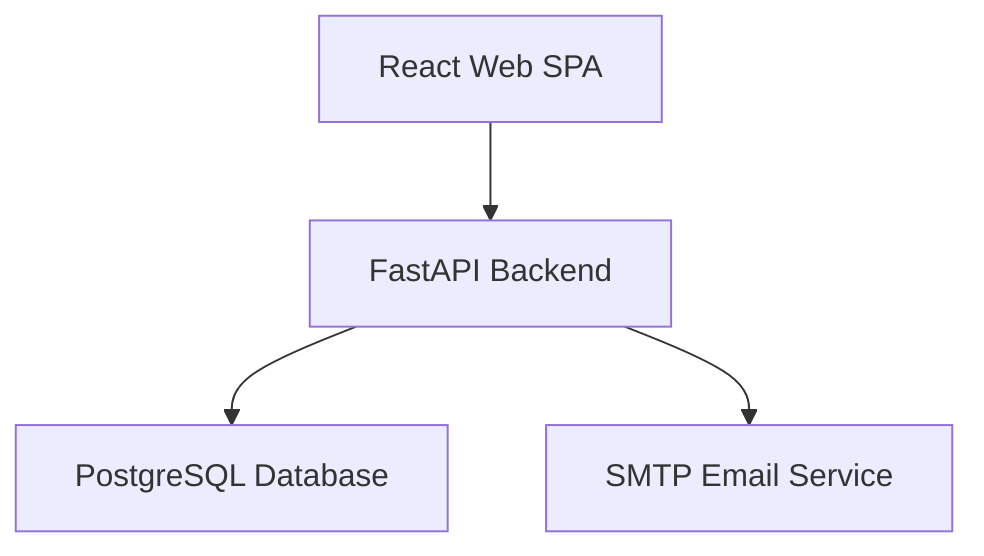
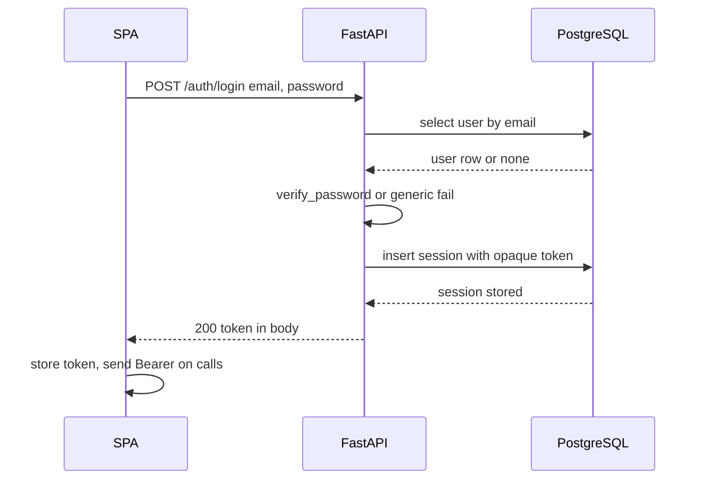
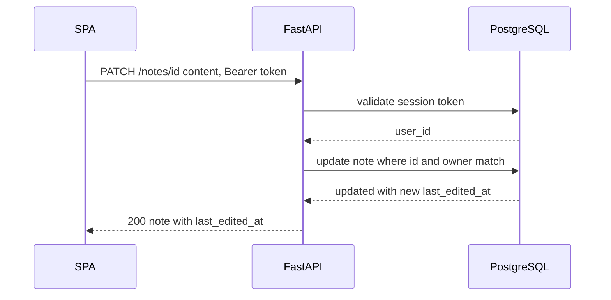
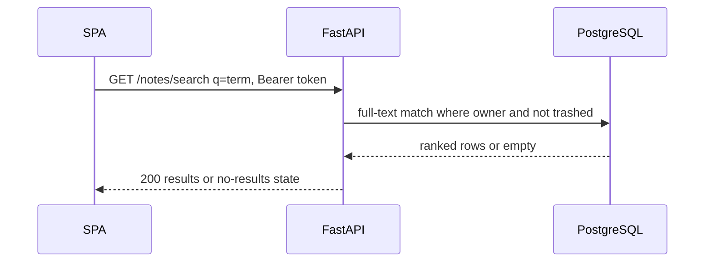
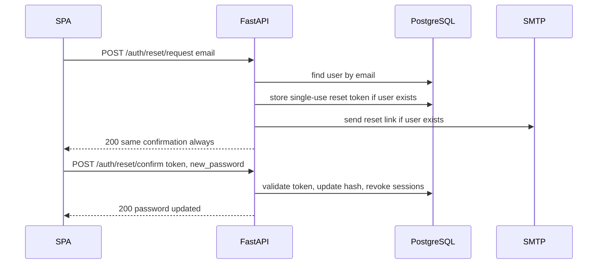
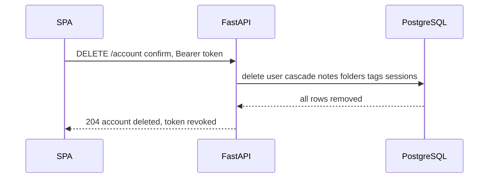
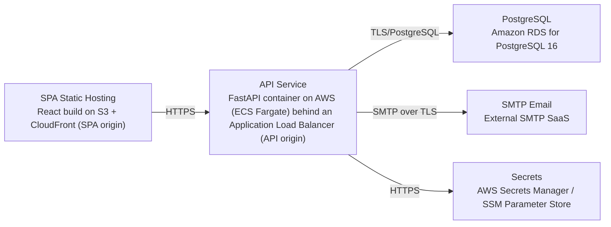

# Architecture

> Maintained by QuorQ AI SDLC. Text between `sdlc:auto` markers is regenerated; anything outside them is yours and is kept.

<!-- sdlc:auto:start narrative -->
## Overview

### ARCH-OVERVIEW · approved · source: architecture:summary

Lightweight, privacy-focused notepad: React 19 SPA over HTTPS to a FastAPI backend, backed by a single PostgreSQL 16 database on AWS.

Users self-register and sign in with email/password; sessions are server-side opaque Bearer tokens persisting per device, revocable on sign-out, password reset or account deletion. Notes are rich text (bold, lists, headings) that auto-save with a last-edited timestamp, organised with folders and tags, and found via PostgreSQL's built-in full-text search. Deleted notes go to trash before permanent removal; users can permanently delete their whole account and data. Transactional email (password reset) goes through an approved SMTP service. Each user only ever sees their own rows, enforced in every query.

**Related:** REQ-TECH-STACK, REQ-SCOPE

### ARCH-COMP-web-frontend · approved · source: architecture:component:web_frontend

React 19 Web SPA is the sole client, serving desktop and mobile browsers from one codebase.

Responsive browser UI: registration/sign-in, note list dashboard, rich-text editor with auto-save, folders/tags, search, trash and account settings. Stores the opaque session token and sends it as Authorization: Bearer on every API call.

**Related:** REQ-FEAT-WRITING, REQ-FEAT-ORGANIZE, REQ-FEAT-SIGNIN

### ARCH-COMP-api-backend · approved · source: architecture:component:api_backend

FastAPI backend is the single REST API serving auth, notes, folders/tags, search and trash.

Handles auth and sessions, note CRUD with auto-save, folders/tags, full-text search, trash lifecycle, password reset and self-service account deletion. Enforces per-user data isolation on every query and hashes passwords.

**Related:** REQ-FEAT-SIGNIN, REQ-FEAT-TRASH, REQ-NFR-001, REQ-NFR-002

### ARCH-COMP-database · approved · source: architecture:component:database

PostgreSQL 16 is the single durable store, including built-in full-text search.

Durable store for users, sessions, notes (rich-text content), folders, tags, note-tag links and trash state. Provides full-text search via tsvector/GIN indexes so no separate search engine is needed.

**Related:** REQ-FEAT-ORGANIZE

### ARCH-COMP-email-service · approved · source: architecture:component:email_service

External SMTP SaaS sends transactional password-reset emails.

Sends transactional password-reset emails with a time-limited, single-use link.

**Related:** REQ-SERVICES, REQ-NFR-004

### ARCH-PATH-signin · approved · source: architecture:critical_path:Sign-in and session issuance

Sign-in verifies a password hash and issues an opaque, server-persisted session token.

User submits email/password; backend verifies the hash and issues an opaque session token persisted server-side. Generic error on failure so email existence is not revealed. Token persists per device and is used on every subsequent call.

**Related:** REQ-FEAT-SIGNIN, REQ-NFR-005

### ARCH-PATH-autosave · approved · source: architecture:critical_path:Auto-save a note with last-edited timestamp

Debounced PATCH calls auto-save note content and refresh the last-edited timestamp and search index.

As the user pauses typing, the SPA debounces and PATCHes the note content; backend updates content, refreshes last_edited_at and the full-text search vector, scoped to the owner.

**Related:** REQ-FEAT-WRITING

### ARCH-PATH-search · approved · source: architecture:critical_path:Full-text search of active notes

Search runs a PostgreSQL tsvector/GIN full-text query scoped to the user's non-trashed notes.

User enters a term; backend runs a PostgreSQL full-text query over the user's non-trashed notes using tsvector/GIN, returning matches or a no-results state. Trashed notes are excluded.

**Related:** REQ-FEAT-ORGANIZE

### ARCH-PATH-reset · approved · source: architecture:critical_path:Password reset via email

Password reset always returns the same confirmation; only existing accounts get a time-limited single-use token emailed via SMTP.

User requests a reset; backend always returns the same confirmation, and only for an existing account creates a time-limited single-use token and sends the link via SMTP. Setting a new password updates the hash and revokes all sessions.

**Related:** REQ-FEAT-SIGNIN, REQ-NFR-004, REQ-NFR-005

### ARCH-PATH-deletion · approved · source: architecture:critical_path:Self-service account and data deletion

Account deletion cascades all user data removal in one transaction.

Signed-in user confirms deletion; backend permanently removes the user and cascades all notes (including trash), folders, tags, note-tag links and sessions in one transaction.

**Related:** REQ-FEAT-SIGNIN, REQ-NFR-006

### ARCH-ENTITIES · approved · source: architecture:entities

Data model: users, sessions, password reset tokens, folders, notes, tags, and note-tag links.

- users: id, email, password_hash, created_at
- sessions: id, user_id, token_hash, created_at, last_used_at, expires_at
- password_reset_tokens: id, user_id, token_hash, expires_at, used_at, created_at
- folders: id, user_id, name, created_at
- notes: id, user_id, folder_id, title, content_html, content_text, search_vector, is_trashed, trashed_at, last_edited_at, created_at
- tags: id, user_id, name
- note_tags: note_id, tag_id

### ARCH-ENDPOINTS · approved · source: architecture:endpoints

Full REST API surface for auth/sessions, notes, folders, tags, trash and search.

- POST /auth/register — self-register, rejects duplicate email/invalid fields.
- POST /auth/login — sign in, returns opaque session token; generic error on failure.
- POST /auth/logout — revokes current session token.
- POST /auth/reset/request — same confirmation regardless of account existence.
- POST /auth/reset/confirm — sets new password via time-limited single-use token; revokes existing sessions.
- DELETE /account — permanently deletes account and all data after confirmation; revokes sessions.
- GET /notes — lists active notes with title/preview/last-edited; supports folder_id and tag_id filters.
- POST /notes — creates a new empty note.
- GET /notes/{id} — gets a single owned note with content and tags.
- PATCH /notes/{id} — auto-saves changes (title, content, folder); updates last_edited_at and search vector.
- POST /notes/{id}/trash — moves note to trash.
- POST /notes/{id}/restore — restores a trashed note.
- DELETE /notes/{id} — permanently deletes a trashed note.
- GET /trash — lists trashed notes.
- DELETE /trash — empties trash after confirmation.
- GET /notes/search — full-text search over active notes; excludes trashed.
- GET /folders — lists folders.
- POST /folders — creates a folder.
- DELETE /folders/{id} — deletes a folder; its notes become unfiled.
- GET /tags — lists tags.
- POST /notes/{id}/tags — adds tags to a note (creating as needed).
- DELETE /notes/{id}/tags/{tag_id} — removes a tag from a note.

### ARCH-DEPLOY-NODES · approved · source: architecture:deployment_nodes

AWS deployment topology: static SPA hosting, containerized API, managed Postgres, external SMTP, and managed secrets.

- SPA Static Hosting: React build on S3 + CloudFront (SPA origin), static assets.
- API Service: FastAPI container on AWS ECS Fargate behind an Application Load Balancer (API origin), Python 3.12 / Uvicorn.
- PostgreSQL: Amazon RDS for PostgreSQL 16.
- SMTP Email: external SMTP SaaS, managed.
- Secrets: AWS Secrets Manager / SSM Parameter Store, managed.

### ARCH-TECH-DECISIONS · approved · source: architecture:technology_decisions

Architecture-level rationale for each approved stack choice and considered alternatives.

- Frontend: React 19 (alternatives considered: Vue, Svelte) — drives the responsive SPA (editor, auto-save, folders/tags, search, trash); reads VITE_API_BASE_URL, sends opaque session token as Bearer header.
- Backend: FastAPI 0.115 (alternatives: Django, Flask) — handles auth/sessions, note CRUD, search, trash, reset, deletion for thousands of users; enforces per-user isolation in every query.
- Database: PostgreSQL 16 (alternatives: MySQL, SQLite) — stores all structured/relational data; built-in full-text search via tsvector/GIN avoids a separate search engine.
- Cloud: AWS (alternatives: GCP, Azure) — managed RDS with backups, Fargate hosting, S3/CloudFront, Secrets Manager/TLS — reliable and cheap at modest scale.

**Related:** REQ-TECH-STACK
<!-- sdlc:auto:end narrative -->

<!-- sdlc:auto:start building-blocks -->
## Building Block View

| ID | Name | Technology | Responsibility | Depends on |
|---|---|---|---|---|
| web_frontend | React Web SPA | React 19 | Responsive browser UI: registration/sign-in, note list dashboard, rich-text editor with auto-save, folders/tags, search, trash and account settings. Stores the opaque session token and sends it as Authorization: Bearer on every API call. | api_backend |
| api_backend | FastAPI Backend | FastAPI 0.115 | REST API for auth and sessions, note CRUD with auto-save, folders/tags, full-text search, trash lifecycle, password reset and self-service account deletion. Enforces per-user data isolation on every query and hashes passwords. | database, email_service |
| database | PostgreSQL Database | PostgreSQL 16 | Durable store for users, sessions, notes (rich-text content), folders, tags, note-tag links and trash state. Provides full-text search via tsvector/GIN indexes so no separate search engine is needed. | — |
| email_service | SMTP Email Service | SMTP server (external SaaS) | Sends transactional password-reset emails with a time-limited, single-use link. | — |

<!-- sdlc:auto:end building-blocks -->

<!-- sdlc:auto:start runtime -->
## Runtime View

### Sign-in and session issuance

User submits email/password; backend verifies the hash and issues an opaque session token persisted server-side. Generic error on failure so email existence is not revealed. Token persists per device and is used on every subsequent call.

- **Components:** web_frontend, api_backend, database
- **Modules:** auth.router, auth.service, auth.password, session.repository
- **Key functions:** sign_in(email, password), verify_password(password, hash), create_session(user_id), get_user_by_email(email)

### Auto-save a note with last-edited timestamp

As the user pauses typing, the SPA debounces and PATCHes the note content; backend updates content, refreshes last_edited_at and the full-text search vector, scoped to the owner.

- **Components:** web_frontend, api_backend, database
- **Modules:** notes.router, notes.service, notes.repository
- **Key functions:** autosave_note(user_id, note_id, content), update_note(user_id, note_id, fields), assert_owner(user_id, note_id)

### Full-text search of active notes

User enters a term; backend runs a PostgreSQL full-text query over the user's non-trashed notes using tsvector/GIN, returning matches or a no-results state. Trashed notes are excluded.

- **Components:** web_frontend, api_backend, database
- **Modules:** search.router, search.service, notes.repository
- **Key functions:** search_notes(user_id, query), to_tsquery(query)

### Password reset via email

User requests a reset; backend always returns the same confirmation, and only for an existing account creates a time-limited single-use token and sends the link via SMTP. Setting a new password updates the hash and revokes all sessions.

- **Components:** web_frontend, api_backend, database, email_service
- **Modules:** auth.reset.router, auth.reset.service, email.client, session.repository
- **Key functions:** request_reset(email), create_reset_token(user_id), send_reset_email(email, link), confirm_reset(token, new_password), revoke_all_sessions(user_id)

### Self-service account and data deletion

Signed-in user confirms deletion; backend permanently removes the user and cascades all notes (including trash), folders, tags, note-tag links and sessions in one transaction.

- **Components:** web_frontend, api_backend, database
- **Modules:** account.router, account.service, user.repository
- **Key functions:** delete_account(user_id), cascade_delete_user_data(user_id)

<!-- sdlc:auto:end runtime -->

<!-- sdlc:auto:start deployment-view -->
## Deployment View

| Name | Service | Runtime | Scaling | Environment |
|---|---|---|---|---|
| SPA Static Hosting | React build on S3 + CloudFront (SPA origin) | Static assets | CDN-backed, no server scaling | dev |
| API Service | FastAPI container on AWS (ECS Fargate) behind an Application Load Balancer (API origin) | Python 3.12 / Uvicorn | 1 task for dev, horizontal task scaling if needed | dev |
| PostgreSQL | Amazon RDS for PostgreSQL 16 | PostgreSQL 16 | Single managed instance with automated backups | dev |
| SMTP Email | External SMTP SaaS | Managed | Provider-managed | dev |
| Secrets | AWS Secrets Manager / SSM Parameter Store | Managed | Managed | dev |

| Source | Target | Protocol |
|---|---|---|
| SPA Static Hosting | API Service | HTTPS |
| API Service | PostgreSQL | TLS/PostgreSQL |
| API Service | SMTP Email | SMTP over TLS |
| API Service | Secrets | HTTPS |

<!-- sdlc:auto:end deployment-view -->

<!-- sdlc:auto:start decisions -->
## Architecture Decisions

| Layer | Choice | ADR |
|---|---|---|
| Frontend | React 19 | [ADR-0001](adr/frontend.md) |
| Backend | FastAPI 0.115 | [ADR-0002](adr/backend.md) |
| Database | PostgreSQL 16 | [ADR-0003](adr/database.md) |
| Cloud | AWS | [ADR-0004](adr/cloud.md) |
<!-- sdlc:auto:end decisions -->

<!-- sdlc:auto:start links -->
## Related Documents

- [Data Model](data-model.md)
- [API Specification](api/openapi.yaml)
- [Architecture Decision Records](adr/README.md)
<!-- sdlc:auto:end links -->
