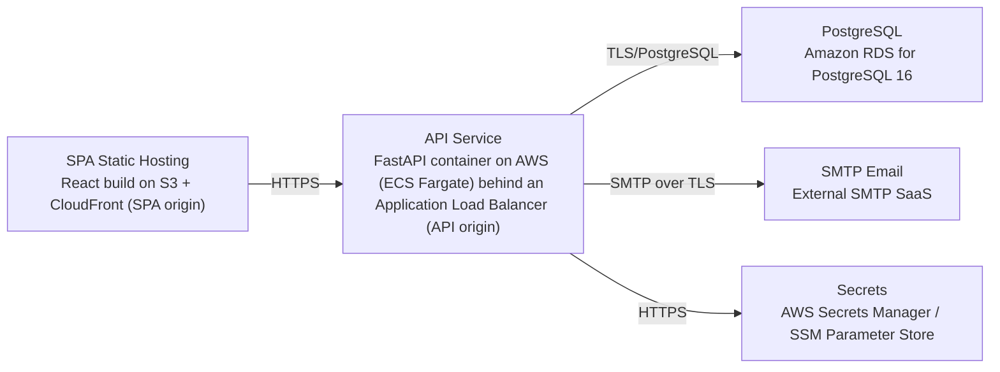

# Deployment Guide

> Maintained by QuorQ AI SDLC. Text between `sdlc:auto` markers is regenerated; anything outside them is yours and is kept.

<!-- sdlc:auto:start how-it-deploys -->
Pushes to `main` run `.github/workflows/deploy.yml`, which builds the API image (if there is a backend) and deploys the SPA to AWS Amplify. Commits touching only `docs/sdlc/**` don't deploy. Deployments can also be started from the platform's Deployment tab.
<!-- sdlc:auto:end how-it-deploys -->

<!-- sdlc:auto:start environments -->
| Name | Service | Runtime | Scaling | Environment |
|---|---|---|---|---|
| SPA Static Hosting | React build on S3 + CloudFront (SPA origin) | Static assets | CDN-backed, no server scaling | dev |
| API Service | FastAPI container on AWS (ECS Fargate) behind an Application Load Balancer (API origin) | Python 3.12 / Uvicorn | 1 task for dev, horizontal task scaling if needed | dev |
| PostgreSQL | Amazon RDS for PostgreSQL 16 | PostgreSQL 16 | Single managed instance with automated backups | dev |
| SMTP Email | External SMTP SaaS | Managed | Provider-managed | dev |
| Secrets | AWS Secrets Manager / SSM Parameter Store | Managed | Managed | dev |
<!-- sdlc:auto:end environments -->

<!-- sdlc:auto:start live -->
_Not deployed yet._
<!-- sdlc:auto:end live -->

<!-- sdlc:auto:start topology -->

<!-- sdlc:auto:end topology -->
